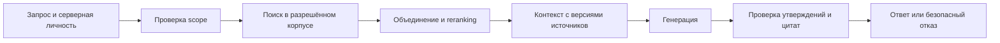

# Модуль 4. Самостоятельная работа

[Обзор модуля](README.md) · [Все материалы](../../README.md) · [Программа](../../../curriculum.md)

## Маршрут изучения

**3 академических часа (135 минут):** ingestion и chunking — 30 минут; поиск и reranking — 35; метрики — 25; ответы, ACL и жизненный цикл — 30; самопроверка — 15. Предпосылки — [модуль 1](../01-llm-foundations/self-study.md) и [протокол оценки и безопасности](../03-evaluation-data-security/self-study.md).

После чтения вы сможете разделять ошибки поиска и генерации, объяснить выбор размера фрагмента, прочитать retrieval-метрики и проследить права от источника до ответа. Конспект готовит к П4.1–П4.4, не задавая их реализацию.

## 1. Два контура RAG

Retrieval-Augmented Generation связывает генератор с внешними источниками. В [исходной работе RAG](https://arxiv.org/abs/2005.11401) изучается сочетание параметрической памяти модели и извлечённого контекста; промышленная реализация дополнительно требует ACL, актуальности и эксплуатации.

Контур подготовки: `источник → извлечение → нормализация → фрагменты → представления → индекс`. Контур ответа: `личность и права → запрос → разрешённые кандидаты → ранжирование → контекст → ответ → проверка цитат`. Изменение любого этапа способно изменить результат, даже если LLM осталась прежней.



На схеме право ограничивает кандидатов раньше reranking и генерации. Проверка в конце не заменяет эту границу.

Начальный baseline — обычный поиск с корректными метаданными и фильтрами. Поиск точного артикула часто выигрывает у смыслового поиска. RAG оправдан, когда сформированный ответ с источниками экономит время и сохраняет правильность; он не обязателен для выдачи списка документов.

## 2. Источник, фрагмент и метаданные

Индекс должен сохранять происхождение: идентификатор документа, редакцию, страницу, секцию/координаты при наличии, время актуальности, checksum и policy/ACL. Номер страницы PDF и печатный номер могут различаться — интерфейс должен однозначно их трактовать. URL без версии часто ведёт уже к новому содержимому.

Chunking выбирает единицу retrieval. Маленький фрагмент легче попадает в контекст, но может потерять заголовок, условия применимости или единицу таблицы. Большой сохраняет смысл, но включает лишнее и расходует контекст. Overlap уменьшает разрыв границ, но создаёт дубли и не заменяет структурное разбиение.

Для регламентов разумно учитывать разделы и списки; для таблицы — заголовки колонок и строки; для C# — символы, контракты и зависимости. У документа с OCR нужно сначала оценить структуру: разрезание ошибочно перемешанных колонок не исправит порядок чтения. Значение размера chunk нельзя переносить между языками и токенизаторами без проверки.

Синтетическое представление фрагмента:

```json
{
  "chunk_id": "reg-17:rev-3:p-8:s-2",
  "document_id": "reg-17",
  "revision": "3",
  "page_pdf": 8,
  "section": "2",
  "policy_id": "training-engineering",
  "text": "Синтетический регламент: проверка выполняется перед выпуском."
}
```

`policy_id` — ссылка на серверную политику, а не разрешение из текста документа. Политики приходят из доверенного источника; произвольные метаданные загружаемого PDF не должны назначать права.

## 3. Ключевой, векторный и гибридный поиск

Ключевой поиск сопоставляет термы; BM25 учитывает частоту терма, редкость и длину документа. Он полезен для обозначений и точных терминов. Морфология, словари синонимов и нормализация кириллицы/латиницы требуют контроля: замена `О` на `0` может испортить артикул.

Bi-encoder независимо кодирует запрос и документ в векторы. При косинусной близости сравнивается направление: `cos(q,d)=q·d/(||q||||d||)`. Для некоторых моделей важны разные префиксы запроса и документа, нормализация и выбранная метрика расстояния. Замена embedding-модели обычно требует переиндексации: векторы разных пространств несопоставимы, даже если размерность одинаковая.

Точный поиск считает расстояния по всем разрешённым векторам; ANN приближает его ради скорости. HNSW/IVF требуют компромисса полноты, памяти и latency. У ANN есть собственная потеря относительно точного поиска, которую следует отличать от недостатков embedding-модели. [pgvector](https://github.com/pgvector/pgvector) описывает точный и приближённый поиск и особенности фильтрации. Фильтр после выборки кандидатов может уменьшить фактическое число результатов; простого `WHERE` недостаточно, чтобы без измерений гарантировать Recall@k.

В гибридном поиске объединяют lexical и dense списки. Прямое сложение их исходных score часто некорректно из-за разных шкал. Reciprocal Rank Fusion суммирует `1/(c+rank)` для документа в каждом списке. c выбирается на dev; значение 60 в примере — иллюстрация, не норматив курса.

```python
from collections import defaultdict


def rrf(rankings, c=60):
    scores = defaultdict(float)
    for ranking in rankings:
        unique = list(dict.fromkeys(ranking))
        for rank, doc_id in enumerate(unique, start=1):
            scores[doc_id] += 1 / (c + rank)
    return sorted(scores, key=lambda d: (-scores[d], d))


print(rrf([["A", "B", "C"], ["B", "D", "A"]]))  # ['B', 'A', 'D', 'C']
```

Пример использует только стандартную библиотеку и уже разрешённые списки. Он не реализует поиск, хранение ACL или индексацию.

Reranker совместно рассматривает запрос и каждый кандидат; поэтому может лучше учитывать отрицания и условия, но дороже bi-encoder. Он переставляет найденное и не возвращает отсутствующий документ. Если релевантного кандидата нет даже в широком top-N, сначала диагностируют retrieval. Архитектуру описывает [Sentence Transformers: Retrieve & Re-Rank](https://www.sbert.net/examples/sentence_transformer/applications/retrieve_rerank/README.html).

## 4. Метрики retrieval на разобранном примере

Для запроса размечают множество релевантных документов и при необходимости степень релевантности. Неизвестный документ не всегда нерелевантен: при неполной разметке требуется экспертный просмотр кандидатов от разных систем. Релевантность оценивается среди разрешённых пользователю источников; скрытый документ не должен улучшать метрику.

Пусть релевантны A и B, а выдача — C, B, A:

- `Recall@2 = 1/2`: из двух нужных документов в первых двух найден один.
- `Precision@2 = 1/2`: из двух выданных один релевантен.
- `RR = 1/2`: первый релевантный на второй позиции; MRR — среднее RR по запросам.
- `DCG@k = Σ(2^rel_i−1)/log2(i+1)`; `nDCG@k = DCG/IDCG`, где IDCG — лучшая возможная сортировка тех же оценок.

При бинарной релевантности здесь `nDCG@3 ≈ (1/log2(3)+1/log2(4))/(1+1/log2(3)) ≈ 0,693`. nDCG полезен при градуированных оценках и важности порядка. Для запросов без релевантного документа Recall/nDCG могут быть неопределёнными; заранее фиксируют соглашение и отдельно оценивают abstention. Это не повод удалить неудобные случаи из end-to-end оценки.

Recall@k по фрагментам и по документам — разные метрики. Пять почти одинаковых фрагментов одной страницы не равны пяти независимым доказательствам. Среднее по запросам дополняют срезами: артикулы, отрицания, русские сокращения, конфликт редакций, вопросы без ответа и недоступные источники.

## 5. Генерация ответа и abstention

Контекст собирается с учётом бюджета токенов, удаления дублей, действующих версий и структуры. Увеличение top-k способно ухудшить ответ из-за шума и конфликтов. Поведение при двух противоречащих редакциях определяется предметным правилом актуальности; модель не должна молча выбирать удобный текст.

Отдельно оцениваются: правильность утверждений, полнота по вопросу, подтверждённость источниками, корректность ссылок и отказ. Цитата может существовать, но не подтверждать соседнее утверждение. Для проверки нужна связь «утверждение → фрагмент → версия». Требование «используй только контекст» помогает сформулировать задачу, но не гарантирует её выполнение.

Abstention — отказ от содержательного ответа при недостаточности доказательств. Порог векторного score не универсален: он зависит от модели и корпуса и сам по себе не является вероятностью. Правило отказа настраивают на dev с ответными и безответными вопросами, затем измеряют coverage, ошибочные ответы и избыточные отказы на test.

Технический отказ генератора учитывается отдельно от abstention. Таймаут, пустой массив `choices` и `content=null` означают сбой зависимости или нарушение контракта. Корректный JSON тоже может быть числом, списком или объектом с неверными типами полей. Поэтому сначала проверяют структуру ответа провайдера, затем схему сгенерированного объекта и допустимые ID цитат. Случай остаётся в общем знаменателе; его нельзя записать как правильный отказ по недостатку источников. В [эталоне](../../practice-kit/scripts/rag.py) для сбоя зависимости используется `dependency_error`, для некорректного содержания — безопасный отказ без цитат.

[RAGAS](https://docs.ragas.io/en/stable/concepts/metrics/overview/) предлагает вспомогательные метрики компонентов и всей системы. Любая judge-based метрика требует локально разрешённого судьи, калибровки и человеческой проверки критичных случаев по [модулю 3](../03-evaluation-data-security/self-study.md). Нельзя отправлять закрытые контексты внешнему судье из-за настроек по умолчанию библиотеки.

## 6. ACL и жизненный цикл корпуса

Личность и разрешённый scope устанавливаются сервером. Retrieval выполняется в разрешённом пространстве; только такие кандидаты поступают в reranker и генерацию. Фильтрация уже готового ответа опаздывает: закрытый текст мог попасть в контекст, логи или кэш. [Qdrant filtering](https://qdrant.tech/documentation/search/filtering/) описывает механизм фильтров; корректная политика доступа остаётся обязанностью приложения.

Кэш должен учитывать права, версию политики и корпуса. Одинаковый вопрос двух пользователей не даёт права вернуть один ответ. После отзыва прав нужно исключить также старые результаты, историю и доступ по прямой ссылке; при сомнении система закрывает доступ. Повторная серверная проверка перед выдачей защищает от изменения прав между поиском и ответом.

Обновление источника связывают с новой ревизией фрагментов. Удаление распространяется на индекс, текстовое хранилище, кэши и правила retention резервных копий. Физическое удаление из резервов может иметь отдельный срок; до его истечения восстановление не должно возвращать доступ к удалённому содержимому. Нужен журнал tombstone/отзыва и проверка после восстановления.

Согласованное переключение между версиями индекса предотвращает смешение старых векторов и новых текстов. Манифест фиксирует корпус, embedding-модель, chunking и конфигурацию. После восстановления повторяют проверки retrieval, ссылок и ACL, а не только считают число записей.

## 7. Самопроверка с пояснениями

1. Поможет ли reranker, если документ отсутствует в top-100? **Ответ:** нет, нужно исследовать ingestion, фильтры и retrieval.
2. Почему нельзя сравнивать два варианта на разных наборах? **Ответ:** изменение сложности смешается с эффектом технологии.
3. Верная ссылка гарантирует верный ответ? **Ответ:** требуется проверить, поддерживает ли источник конкретное утверждение и актуальна ли версия.
4. Почему удаление записи из векторной БД недостаточно? **Ответ:** остаются тексты, кэши, история, ссылки и восстановимые копии.

## Источники и дальнейшее чтение

- [RAG: исходная статья](https://arxiv.org/abs/2005.11401) — идея внешней непараметрической памяти.
- [pgvector](https://github.com/pgvector/pgvector) — метрики расстояния, ANN и фильтрация.
- [Qdrant filtering](https://qdrant.tech/documentation/search/filtering/) — сочетание поиска и ограничений метаданных.
- [Sentence Transformers: Retrieve & Re-Rank](https://www.sbert.net/examples/sentence_transformer/applications/retrieve_rerank/README.html) — bi-encoder и cross-encoder.
- [RAGAS: обзор метрик](https://docs.ragas.io/en/stable/concepts/metrics/overview/) — вспомогательная оценка; обязательна человеческая калибровка.
