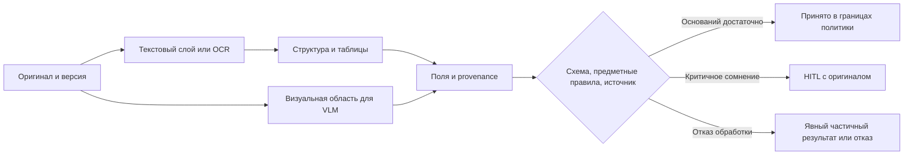

# Модуль 5. Теория и самостоятельное изучение

[Обзор модуля](README.md) · [Все материалы](../../README.md) · [Программа](../../../curriculum.md)

## Маршрут изучения

**4 академических часа (180 минут):** PDF, OCR и анализ структуры — 40 минут; таблицы и метрики — 35; извлечение и происхождение значений — 40; VLM и HITL — 45; самопроверка — 20. Предпосылки — [оценка и безопасность](../03-evaluation-data-security/self-study.md) и [RAG](../04-rag/self-study.md). Цель — понимать весь путь от страницы до проверенного значения и отличать ошибку распознавания текста от ошибки восстановления структуры или интерпретации.

## 1. Документ — не строка текста

Текстовый PDF может содержать символы с координатами, скан — только изображение, а смешанный PDF — оба варианта на разных страницах. Наличие текстового слоя не доказывает качества извлечения: результаты OCR в скрытом слое могут содержать ошибки или не совпадать с видимым изображением. Следует сохранять оригинал и проверять каждую страницу отдельно.

Пайплайн можно представить так: `проверка файла → определение типа страницы → извлечение текста или рендеринг → OCR → анализ структуры → распознавание таблиц → нормализация → поля/фрагменты → валидация → HITL`. Конкретный маршрут зависит от типа страницы. OCR распознаёт символы, анализ макета (layout analysis) определяет области и порядок чтения, распознавание таблиц (table recognition) — структуру ячеек. LLM не должна незаметно исправлять ошибки предыдущих этапов без подтверждения по источнику.



Ветвь VLM используют, когда анализ ошибок показывает необходимость визуальной обработки; не каждый документ должен проходить через все модели. Проверки должны подтверждать происхождение и правильность значений, а не только формат JSON.

Парсер PDF работает в изолированной среде с ограничением размера, числа страниц, времени и памяти. Повреждённые и зашифрованные файлы, огромные изображения и повторные загрузки — штатные классы отказов. Идентификатор документа и версия обработки позволяют повторять этапы без неконтролируемых дублей. Хэш файла позволяет обнаружить точный дубликат, но не распознаёт повторно отсканированную страницу.

## 2. Предобработка и оценка OCR

Поворот, наклон, шум, фон, печати и слабый контраст ухудшают распознавание. В [документации Tesseract](https://tesseract-ocr.github.io/tessdoc/ImproveQuality.html) разобраны изменение масштаба, бинаризация и сегментация. Обработка может и навредить: агрессивное удаление шума стирает точку, знак допуска или тонкую линию. Поэтому исходное изображение сохраняется, а параметры предобработки версионируются и сравниваются на одинаковых страницах.

При распознавании можно перепутать похожие кириллические и латинские буквы, а также цифры: `С/C`, `Р/P`, `О/0`. В обозначениях существенны регистр, точки и дефисы. Словарная коррекция полезна для обычных слов, но может искажать артикулы. Рукописные пометки и печатный текст могут требовать разных маршрутов обработки. Эти категории следует оценивать отдельно.

CER — расстояние Левенштейна по символам, делённое на длину эталона; WER — аналогичная метрика по словам. Вставки могут сделать значение больше 1. Правила обработки пробелов, регистра, Unicode и пунктуации задаются заранее. Удаление всех знаков способно искусственно улучшить CER, скрыв потерю `±`.

Пример на Python использует стандартную библиотеку; функция работает и со строкой, и со списком слов:

```python
def edit_distance(reference, prediction):
    prev = list(range(len(prediction) + 1))
    for i, a in enumerate(reference, start=1):
        curr = [i]
        for j, b in enumerate(prediction, start=1):
            curr.append(min(curr[-1] + 1, prev[j] + 1, prev[j - 1] + (a != b)))
        prev = curr
    return prev[-1]


reference, prediction = "10±0,1", "10+0,1"
cer = edit_distance(reference, prediction) / len(reference)
print(round(cer, 3))  # 0.167: одна ошибка из шести символов
```

Для пустого эталона нормированная метрика не определена; выдуманные символы и поля считают отдельно. Micro-CER суммирует ошибки и символы, macro-CER усредняет показатели страниц. В micro-CER больший вес имеют длинные страницы, а в macro-CER все страницы вносят одинаковый вклад. Даже низкий общий CER не доказывает правильность единственного критичного размера.

## 3. Структура и таблицы

При обработке страницы с двумя колонками правильно распознанные слова могут соединиться в неверное предложение. Поэтому помимо текста оценивают порядок чтения, типы блоков и связи между ними. Для оценки совпадения областей используют IoU — площадь их пересечения, делённую на площадь объединения; совпадение ограничивающих прямоугольников (bbox) не доказывает совпадения текста.

Таблица содержит строки, колонки, заголовки, объединённые ячейки, единицы и сноски. Утрата сведений об объединённых ячейках может отнести количество к другой позиции. Для многостраничных таблиц нужно связать продолжение с исходными заголовками, не считать повтор заголовка новой строкой данных и сохранить границу страниц. Объединение по внешнему виду без ключей позиции ненадёжно.

Метрики таблиц разделяют структуру, текст ячеек и предметные значения. TEDS оценивает сходство деревьев HTML-представлений; идея описана в [Image-based table recognition](https://arxiv.org/abs/1911.10683). Высокая структурная оценка не гарантирует правильность единиц и количества. Для спецификации полезны также доли правильно восстановленных позиций, сумм и связей «обозначение–количество–единица».

Для смешанного PDF уместно сравнить baseline извлечения готового текста с OCR и инструментом структурного разбора. Например, [Docling](https://github.com/docling-project/docling) — открытый проект такого класса. Конкретную версию, модели, лицензии и возможность локальной загрузки проверяет организатор; упоминание проекта не гарантирует совместимости всех конфигураций с учебным ПК.

## 4. Извлечение JSON и происхождение значения

При структурированном извлечении сведения из документа преобразуют в данные с заданным контрактом: для полей определены типы, обязательность, допустимые единицы измерения и состояния. Нужно различать «поле отсутствует», «поле есть, но нечитаемо», «значения противоречат друг другу» и «значение прочитано». Подстановка нуля вместо неизвестного превращает пропуск в ложный факт.

JSON Schema задаёт структуру и ограничения; `required` означает наличие ключа, а не непустое или достоверное значение. Запрет дополнительных полей задаётся отдельно — см. [JSON Schema: object](https://json-schema.org/understanding-json-schema/reference/object). После схемы нужна предметная проверка диапазонов, единиц, связей и редакции. Нельзя считать извлечение правильным только потому, что ответ разбирается как JSON.

Следующий фрагмент использует **API Pydantic 2**. Это демонстрация контракта, а не готовый OCR-конвейер; зависимости должны быть закреплены в учебной среде. Координаты здесь нормированы в [0,1] относительно **исходной страницы после согласованного приведения ориентации**.

```python
from typing import Literal

from pydantic import BaseModel, ConfigDict, Field, model_validator


class Source(BaseModel):
    model_config = ConfigDict(extra="forbid", strict=True)
    document_id: str = Field(min_length=1)
    revision: str = Field(min_length=1)
    page: int = Field(ge=1)
    bbox: tuple[float, float, float, float]

    @model_validator(mode="after")
    def check_box(self):
        x0, y0, x1, y1 = self.bbox
        if not (0 <= x0 < x1 <= 1 and 0 <= y0 < y1 <= 1):
            raise ValueError("Неверная область")
        return self


class Diameter(BaseModel):
    model_config = ConfigDict(extra="forbid", strict=True)
    state: Literal["read", "missing", "unreadable", "conflict"]
    value_mm: float | None
    source: Source | None

    @model_validator(mode="after")
    def check_evidence(self):
        if self.state == "read":
            if self.value_mm is None or self.source is None:
                raise ValueError("Нужны значение и источник")
            if not 0 < self.value_mm < float("inf"):
                raise ValueError("Недопустимое значение диаметра")
        elif self.value_mm is not None:
            raise ValueError("Непрочитанное поле не должно иметь значения")
        return self


print(Diameter(state="unreadable", value_mm=None, source=None).state)
```

Модель данных проверяет наличие ссылки, но не подтверждает её достоверность: отдельный код должен проверить существование разрешённого документа, страницы и соответствие значения выделенной области. Pydantic по умолчанию допускает некоторые преобразования типов; в примере выбран strict-режим. Подробности API — [Models](https://docs.pydantic.dev/latest/concepts/models/).

Сведения о происхождении (provenance) связывают значение с оригиналом, редакцией, страницей, областью и версией процедуры извлечения. Для полей, вычисленных из других, сохраняют цепочку преобразований и формулу. Человек должен видеть область и окружающий контекст, чтобы отличить диаметр от допуска или масштаба. При пересчёте координат из фрагмента изображения (crop) в координаты страницы учитывают смещение, поворот и масштаб; ошибка преобразования может сделать правильное значение непроверяемым.

## 5. VLM, большие страницы и чертежи

VLM сопоставляет визуальные признаки и текст. Она может распознать подпись, штамп и расположение элементов, но иногда «додумывает» привычное обозначение. Качество на фотографиях не переносится автоматически на технические схемы.

При уменьшении изображения всей страницы теряются мелкие символы. Разбиение на фрагменты позволяет сохранить исходное разрешение деталей, но может привести к потере связей между областями страницы: например, размер относится к соседнему виду. Полезна иерархия «обзор страницы → область → окружающий контекст» с привязкой к оригиналу. При перекрытии фрагментов нужно удалять дубли извлечённых сведений. Чем больше фрагментов, тем выше стоимость, задержка и риск неверного связывания значений с объектами.

Для чертежей независимо проверяются номинал, верхнее и нижнее отклонения, единицы измерения, позиция и объект, к которому относится размер. `10±0,1 мм` и `10+0,1 мм` — разные инженерные сведения. Нельзя восстанавливать нечитаемый допуск по похожему изделию, стандартному шаблону или «знаниям модели». VLM не должна принимать инженерное решение о годности детали.

В сравнении OCR и VLM сохраняют одинаковые документы и набор оцениваемых полей, но фиксируют разные разрешения, квантование, число фрагментов и затраты. Объём VRAM 12 ГБ ограничивает размер VLM, допустимое разрешение изображений и длину контекста. Решение уменьшить модель или разрешение проверяется на критичных деталях, а не только по отсутствию ошибок нехватки памяти.

## 6. HITL и калибровка неопределённости

Human-in-the-loop (HITL) — участие человека в обработке и принятии решения по заданным правилам. Система отправляет сомнительный случай эксперту, показывает источник, принимает исправление и сохраняет решение с соблюдением правил доступа. Пропускная способность очереди ручной проверки влияет на производительность всей системы; её перегрузка увеличивает время цикла.

Уверенность, которую LLM указывает в ответе, не равна вероятности его правильности. Оценки уверенности OCR, совпадение ответов двух моделей и результаты валидации также нельзя без проверки сводить к единому проценту. Калибровка сопоставляет наблюдаемый сигнал с частотой ошибок на dev-наборе по категориям документов. Порог фиксируется до финальной проверки; для нового шаблона прежняя калибровка может оказаться неприменимой.

Некоторые правила должны быть жёсткими: критичное поле без подтверждённого источника, конфликт редакций, отсутствующая единица или нечитаемый допуск направляются человеку независимо от высокой оценки уверенности. Отказ OCR/VLM не должен запускать ветку угадывания. Для частичного результата полезно вернуть прочитанные поля и явно пометить остальные.

Измеряют одновременно долю ручной проверки, долю ошибок среди автоматически принятых документов, долю всех ошибок, избежавших проверки, и время эксперта. В условной выборке 100 документов проверено 30; среди оставшихся 70 найдены 2 ошибки, а всего ошибок 10. Доля ручной проверки — 30%, доля ошибок среди автоматически принятых документов — 2/70 ≈ 2,86%, доля пропущенных ошибок — 2/10 = 20%. Эти знаменатели отвечают на разные вопросы. Значения условны и не являются порогами.

Избыточная ручная проверка может сделать автоматизацию экономически бессмысленной. Слишком низкая доля ручной проверки может приводить к невыявленным ошибкам. Цель — приемлемый риск и эффективность всего процесса, а не минимизация участия человека любой ценой.

## 7. Разделение данных и негативные случаи

Эталонная разметка включает значения полей, структуру таблиц и координаты областей. Данные разделяют по документам, шаблонам, проектам или времени. Попадание почти одинаковых листов одного проекта в обучающий и тестовый наборы создаёт утечку между выборками. Результаты анализируют отдельно для повёрнутых страниц, шума, печатей, рукописных пометок, обрезанных краёв и многостраничных таблиц.

Негативный случай имеет ожидаемое поведение: отказ парсера, отсутствие поля, безопасное повторение этапа или ручная проверка. Недоверенный текст и изображение могут содержать внедрённые инструкции; они остаются данными, а не инструкциями для вызова инструментов. Производственные данные, оригиналы и области не попадают в облако и общие журналы.

## 8. Самопроверка с пояснениями

1. Почему хороший CER не доказывает правильность спецификации? **Ответ:** одна критичная цифра или неверная строка таблицы может иметь малый вес в общем тексте.
2. Зачем хранить исходные координаты фрагмента? **Ответ:** без обратного преобразования эксперт не найдёт источник на оригинальной странице.
3. Что делать при оценке уверенности 0,99, если читаемый источник допуска отсутствует? **Ответ:** направить человеку; уверенность модели не заменяет доказательство.
4. Почему отказ VLM нельзя автоматически компенсировать догадкой LLM? **Ответ:** появляется критичное значение без наблюдаемого основания.

## Переход к исполняемому примеру

В [практическом комплекте](../../practice-kit/README.md) есть генератор двухстраничных PDF и сканов с кириллицей и дефектами, Tesseract и компактная эталонная реализация `document_pipeline.py`: OCR → поля и позиции → сведения о происхождении → очередь ручной проверки. Соответствие схеме и регулярным выражениям не подтверждает достоверности источника, поэтому по умолчанию критичные значения направляются человеку. Вывод OCR в формате TSV ещё не восстанавливает таблицу документа: порядок блоков и связи строк оцениваются отдельно по П5.1. Небольшая англоязычная VLM позволяет проверить механику обработки фрагментов и работу сервиса; её результаты не доказывают пригодности для чертежей предприятия. Неверный знак допуска исключает автоматическое принятие извлечённого значения.

## Источники и дальнейшее чтение

- [Tesseract: ImproveQuality](https://tesseract-ocr.github.io/tessdoc/ImproveQuality.html) — предобработка и сегментация.
- [Docling](https://github.com/docling-project/docling) — пример структурного разбора документов.
- [Image-based table recognition](https://arxiv.org/abs/1911.10683) — структура таблиц и TEDS.
- [JSON Schema: object](https://json-schema.org/understanding-json-schema/reference/object) — контракт полей.
- [Pydantic: Models](https://docs.pydantic.dev/latest/concepts/models/) — локальная проверка структурированных результатов.
