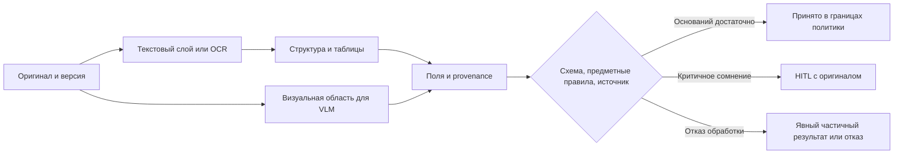

# Модуль 5. Самостоятельная работа

[Обзор модуля](README.md) · [Все материалы](../../README.md) · [Программа](../../../curriculum.md)

## Маршрут изучения

**4 академических часа (180 минут):** PDF/OCR/layout — 40 минут; таблицы и метрики — 35; извлечение и provenance — 40; VLM/HITL — 45; самопроверка — 20. Предпосылки — [оценка и безопасность](../03-evaluation-data-security/self-study.md) и [RAG](../04-rag/self-study.md). Цель — понимать весь путь от страницы до проверенного значения и отличать ошибку чтения от ошибки структуры или интерпретации.

## 1. Документ — не строка текста

Текстовый PDF может содержать символы с координатами, скан — только изображение, а смешанный PDF — оба варианта на разных страницах. Наличие текстового слоя не доказывает качество: скрытый OCR бывает неверным или не совпадает с видимым изображением. Следует сохранять оригинал и диагностировать страницы отдельно.

Пайплайн удобно мыслить так: `проверка файла → тип страницы → извлечение/рендер → OCR → layout → таблицы → нормализация → поля/фрагменты → валидация → HITL`. OCR распознаёт символы, layout определяет области и порядок чтения, table recognition — структуру ячеек. LLM не должна исправлять незаметно ошибки предыдущих этапов без источника.



Ветвь VLM используется по диагностированной потребности; каждый документ не обязан проходить все модели. Проверки подтверждают источник, а не только формат JSON.

Парсер PDF работает в изолированной среде с ограничением размера, числа страниц, времени и памяти. Повреждённые/зашифрованные файлы, огромные изображения и повторные загрузки — штатные классы отказов. Идентификатор документа и версия обработки позволяют повторять этапы без неконтролируемых дублей. Хэш файла полезен для точного дубликата, но не распознаёт повторно отсканированную страницу.

## 2. Предобработка и оценка OCR

Поворот, наклон, шум, фон, печати и слабый контраст ухудшают распознавание. В [документации Tesseract](https://tesseract-ocr.github.io/tessdoc/ImproveQuality.html) разобраны рескейлинг, бинаризация и сегментация. Обработка может и навредить: агрессивное удаление шума стирает точку, знак допуска или тонкую линию. Поэтому исходное изображение сохраняется, а параметры предобработки версионируются и сравниваются на одинаковых страницах.

Кириллица и латиница визуально смешиваются: `С/C`, `Р/P`, `О/0`; в обозначениях существенны регистр, точки и дефисы. Словарная коррекция хороша для обычных слов и опасна для артикулов. Текст рукописной пометки и печатный текст могут требовать разных маршрутов обработки. Метрика должна видеть эти категории отдельно.

CER — расстояние Левенштейна по символам, делённое на длину эталона; WER — аналогично по словам. Вставки могут сделать значение больше 1. Политика пробелов, регистра, Unicode и пунктуации задаётся заранее. Удаление всех знаков способно искусственно улучшить CER, скрыв потерю `±`.

Python, стандартная библиотека; функция работает и со строкой, и со списком слов:

```python
def edit_distance(reference, prediction):
    prev = list(range(len(prediction) + 1))
    for i, a in enumerate(reference, start=1):
        curr = [i]
        for j, b in enumerate(prediction, start=1):
            curr.append(min(curr[-1] + 1, prev[j] + 1,
                            prev[j-1] + (a != b)))
        prev = curr
    return prev[-1]

reference, prediction = "10±0,1", "10+0,1"
cer = edit_distance(reference, prediction) / len(reference)
print(round(cer, 3))  # 0.167: одна ошибка из шести символов
```

Для пустого эталона нормированная метрика не определена; отдельно считают выдуманные символы/поля. Micro-CER суммирует ошибки и символы, macro-CER усредняет страницы; длинные страницы получают разный вес. Даже низкий общий CER не доказывает правильность единственного критичного размера.

## 3. Структура и таблицы

В двух колонках корректные слова могут соединиться в неверное предложение. Поэтому оценка текста дополняется порядком чтения, типами блоков и связями. Для геометрии используют IoU — площадь пересечения областей, делённую на площадь объединения; совпадение bbox не доказывает совпадение текста.

Таблица содержит строки, колонки, заголовки, объединённые ячейки, единицы и сноски. Потерянное объединение способно перенести количество к другой позиции. Для многостраничных таблиц нужно связать продолжение с исходными заголовками, не считать повтор заголовка новой строкой и сохранить границу страниц. Объединение по внешнему виду без ключей позиции ненадёжно.

Метрики таблиц разделяют структуру, текст ячеек и предметные значения. TEDS оценивает сходство деревьев HTML-представления; идея описана в [Image-based table recognition](https://arxiv.org/abs/1911.10683). Высокий структурный score не гарантирует правильность единиц и количества. Для спецификации полезны также доли правильно восстановленных позиций, сумм и связей «обозначение–количество–единица».

Для mixed PDF уместно сравнить baseline извлечения готового текста с OCR и инструментом структурного разбора. Например, [Docling](https://github.com/docling-project/docling) — открытый проект такого класса. Конкретная версия, модели, лицензии и локальность их загрузки проверяются организатором; упоминание не утверждает совместимость всех конфигураций с учебным ПК.

## 4. Извлечение JSON и происхождение значения

Структурированное извлечение переводит документ в контракт: типы, обязательность, допустимые единицы и состояния. Нужно различать «поля нет», «поле есть, но нечитаемо», «значения противоречат друг другу» и «значение прочитано». Подстановка нуля вместо неизвестного превращает пропуск в ложный факт.

JSON Schema задаёт структуру и ограничения; `required` означает наличие ключа, а не непустое или достоверное значение. Закрытие лишних полей задаётся отдельно — см. [JSON Schema: object](https://json-schema.org/understanding-json-schema/reference/object). После схемы нужна предметная проверка диапазонов, единиц, связей и редакции. Нельзя объявлять извлечение верным только потому, что ответ разбирается как JSON.

Следующий фрагмент использует **Pydantic 2 API**. Это демонстрация контракта, не готовый OCR-конвейер; зависимости должны быть закреплены в учебной среде. Координаты здесь нормированы в [0,1] относительно **исходной страницы после согласованного приведения ориентации**.

```python
from typing import Literal
from pydantic import BaseModel, ConfigDict, Field, model_validator

class Source(BaseModel):
    model_config = ConfigDict(extra="forbid", strict=True)
    document_id: str = Field(min_length=1)
    revision: str = Field(min_length=1)
    page: int = Field(ge=1)
    bbox: tuple[float, float, float, float]

    @model_validator(mode="after")
    def check_box(self):
        x0, y0, x1, y1 = self.bbox
        if not (0 <= x0 < x1 <= 1 and 0 <= y0 < y1 <= 1):
            raise ValueError("Неверная область")
        return self

class Diameter(BaseModel):
    model_config = ConfigDict(extra="forbid", strict=True)
    state: Literal["read", "missing", "unreadable", "conflict"]
    value_mm: float | None
    source: Source | None

    @model_validator(mode="after")
    def check_evidence(self):
        if self.state == "read":
            if self.value_mm is None or self.source is None:
                raise ValueError("Нужны значение и источник")
            if not 0 < self.value_mm < float("inf"):
                raise ValueError("Недопустимое значение диаметра")
        elif self.value_mm is not None:
            raise ValueError("Непрочитанное поле не должно иметь значения")
        return self

print(Diameter(state="unreadable", value_mm=None, source=None).state)
```

Модель данных проверяет присутствие ссылки, но не её истинность: отдельный код должен проверить существование разрешённого документа, страницы и соответствие значения выделенной области. Pydantic по умолчанию допускает некоторые преобразования типов; в примере выбран strict-режим. Подробности API — [Models](https://docs.pydantic.dev/latest/concepts/models/).

Provenance связывает значение с оригиналом, редакцией, страницей, областью и версией извлечения. Для полей, вычисленных из других, нужна цепочка преобразований и формула. Человек должен видеть область и соседний контекст, чтобы отличить диаметр от допуска или масштаба. При переносе координат из crop учитываются смещение, поворот и масштаб; ошибка преобразования может сделать правильное значение непроверяемым.

## 5. VLM, большие страницы и чертежи

VLM сопоставляет визуальные признаки и текст. Она может распознать подпись, штамп и расположение элементов, но иногда «додумывает» привычное обозначение. Качество на фотографиях не переносится автоматически на технические схемы.

Вся страница при уменьшении теряет мелкие символы. Фрагментирование сохраняет разрешение локально, но лишает глобальных связей: размер может относиться к соседнему виду. Полезна иерархия «обзор страницы → область → соседний контекст» с привязкой к оригиналу. Перекрытия crop требуют дедупликации. Чем больше фрагментов, тем выше стоимость, latency и риск неоднозначного связывания.

Для чертежей независимо проверяются номинал, верхнее/нижнее отклонение, единица, позиция и объект, к которому относится размер. `10±0,1 мм` и `10+0,1 мм` — разные инженерные сведения. Нельзя восстанавливать нечитаемый допуск по похожему изделию, стандартному шаблону или «знаниям модели». VLM не принимает инженерное решение о годности детали.

В сравнении OCR и VLM сохраняют одинаковые документы и поле оценки, но фиксируют разные разрешения, квантование, число crop и затраты. 12 ГБ VRAM могут ограничивать одновременно размер VLM, изображения и контекст. Решение «меньше модель/разрешение» проверяется на критичных деталях, а не только на факте отсутствия OOM.

## 6. HITL и калибровка неопределённости

Human-in-the-loop — контролируемый маршрут решения. Система отправляет сомнительный случай эксперту, показывает источник, принимает исправление и сохраняет решение по правилам доступа. Очередь эксперта — часть производительности системы; её перегрузка увеличивает время цикла.

Self-reported confidence LLM не равен вероятности верности. OCR confidence, согласие двух моделей и score валидации также нельзя смешать в универсальный процент. Калибровка сопоставляет наблюдаемый сигнал с частотой ошибок на dev по категориям документов. Порог фиксируется до test; новый шаблон может нарушить калибровку.

Некоторые правила должны быть жёсткими: критичное поле без подтверждённого источника, конфликт редакций, отсутствующая единица или нечитаемый допуск направляются человеку независимо от красивого confidence. Отказ OCR/VLM не должен запускать ветку угадывания. Для частичного результата полезно вернуть прочитанные поля и явно пометить остальные.

Измеряют одновременно долю ручной проверки, долю ошибок среди автоматически принятых, долю всех ошибок, избежавших проверки, и время эксперта. В условной выборке 100 документов проверено 30; среди оставшихся 70 найдены 2 ошибки, а всего ошибок 10. Ручная доля — 30%, ошибка в auto-accepted — 2/70 ≈ 2,86%, доля пропущенных ошибок — 2/10 = 20%. Эти знаменатели отвечают на разные вопросы. Значения условны и не являются порогами.

Избыточная ручная проверка может сделать автоматизацию экономически бессмысленной. Слишком низкая ручная доля может скрывать недетектируемые ошибки. Цель — приемлемый риск и эффект всего процесса, а не минимум участия человека любой ценой.

## 7. Разделение данных и негативные случаи

Эталоны включают поля, таблицы и области, а split выполняется по документам/шаблонам/проектам/времени. Почти одинаковые листы одного проекта в train и test создают утечку. Нужны срезы по повороту, шуму, печатям, рукописи, обрезанным краям и многостраничным таблицам.

Негативный случай имеет ожидаемое поведение: отказ парсера, отсутствие поля, безопасное повторение этапа или ручная проверка. Недоверенный текст и изображение могут содержать prompt injection; они остаются данными, а не инструкцией вызвать инструмент. Производственные данные, оригиналы и области не попадают в облако и общие журналы.

## 8. Самопроверка с пояснениями

1. Почему хороший CER не доказывает правильность спецификации? **Ответ:** одна критичная цифра или неверная строка таблицы может иметь малый вес в общем тексте.
2. Зачем хранить исходные координаты crop? **Ответ:** без обратного преобразования эксперт не найдёт источник на оригинальной странице.
3. Что делать с confidence 0,99 при отсутствии читаемого источника допуска? **Ответ:** направить человеку; уверенность модели не заменяет доказательство.
4. Почему отказ VLM нельзя автоматически компенсировать догадкой LLM? **Ответ:** появляется критичное значение без наблюдаемого основания.

## Источники и дальнейшее чтение

- [Tesseract: ImproveQuality](https://tesseract-ocr.github.io/tessdoc/ImproveQuality.html) — предобработка и сегментация.
- [Docling](https://github.com/docling-project/docling) — пример структурного разбора документов.
- [Image-based table recognition](https://arxiv.org/abs/1911.10683) — структура таблиц и TEDS.
- [JSON Schema: object](https://json-schema.org/understanding-json-schema/reference/object) — контракт полей.
- [Pydantic: Models](https://docs.pydantic.dev/latest/concepts/models/) — локальная проверка структурированных результатов.
